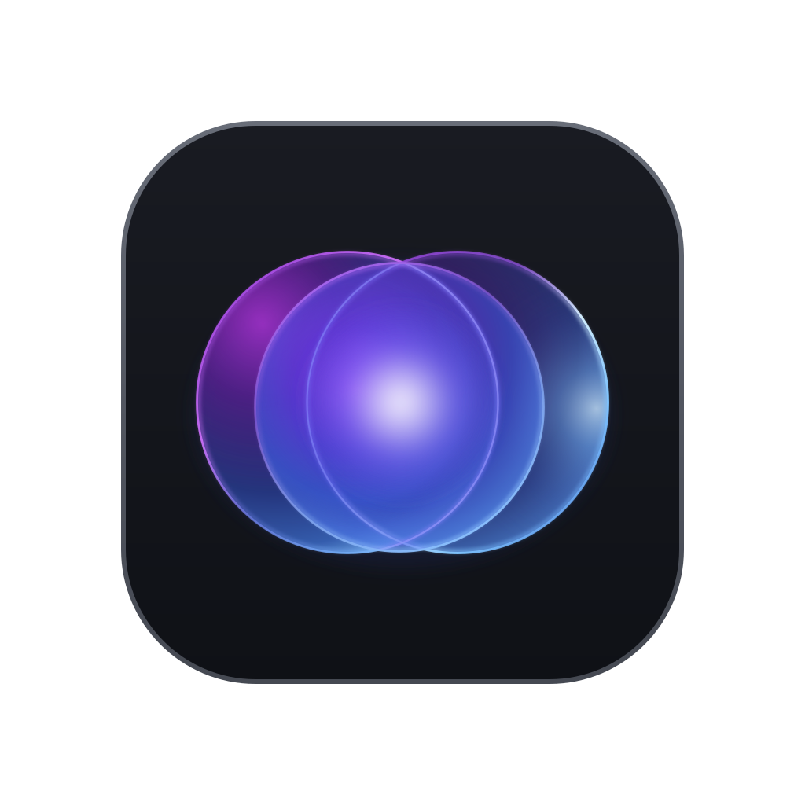
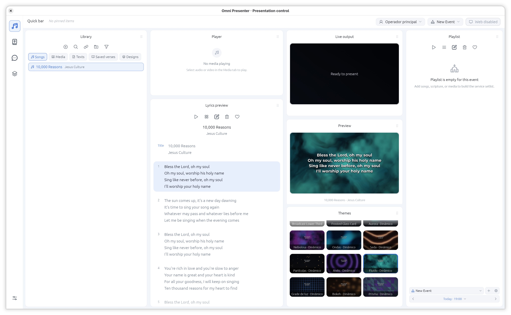
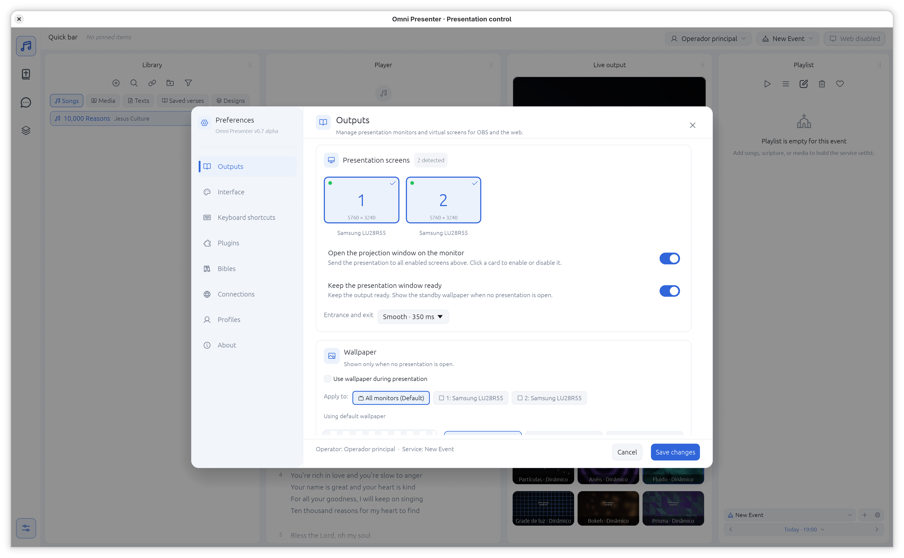

<div align="center">



# Omni Presenter

[English](README.md) · [Português (Brasil)](README.pt-BR.md) · **Español**

**Prepara. Previsualiza. Presenta.**

Un espacio de trabajo para presentaciones en vivo con letras, pasajes bíblicos, medios y diseños, con operación desde el equipo y herramientas para el grupo en el navegador.

[](https://www.rust-lang.org/)
[](#primeros-pasos)
[](LICENSE)
[](docs/operations.md#prerequisites-and-startup)

<br>

[](https://discord.gg/ttUAyhRkF)

<br>

[Primeros pasos](#primeros-pasos) · [Conoce el flujo](#de-la-biblioteca-a-la-presentación) · [Documentación](#documentación) · [Desarrollo](#desarrollo)

</div>

---

## Capturas de pantalla

<div align="center">

| Espacio de trabajo | Configuración y Preferencias |
| :---: | :---: |
|  |  |

</div>

## Un espacio de trabajo, de la preparación a la presentación

Omni Presenter reúne el contenido y los controles de un evento en vivo en una aplicación de escritorio. Crea una lista con elementos de la biblioteca, comprueba el siguiente elemento en la vista previa y mantén independiente la salida en vivo mientras preparas lo que viene después.

| | |
| --- | --- |
| **Crea tu biblioteca** | Organiza canciones y letras, pasajes bíblicos, imágenes, vídeos y textos personalizados para reutilizarlos en eventos. |
| **Planifica el evento** | Prepara listas y trabaja con perfiles de operador y de evento. |
| **Diseña la salida** | Usa temas de presentación y crea composiciones visuales con capas, texto y recursos gráficos. |
| **Mantén el control** | Prepara el contenido en la vista previa antes de enviarlo en vivo a pantallas físicas o al navegador. |
| **Trabaja en equipo** | Activa el control y el chat en el navegador para tu equipo en la red local. |

## De la biblioteca a la presentación

```text
  BIBLIOTECA             VISTA PREVIA           SALIDA EN VIVO
  Canciones · Biblia  →  Comprueba el       →   Pantalla física
  Medios · Diseños       elemento y el tema      o navegador
         │                                              ▲
         └────────────── Lista del evento ──────────────┘
```

1. **Prepara** — añade contenido a la biblioteca y crea una lista para el evento.
2. **Configura** — elige un tema, una proporción y una salida física o virtual.
3. **Previsualiza** — selecciona un elemento y compruébalo sin reemplazar lo que está en vivo.
4. **Presenta** — envía el elemento en vivo y navega por las diapositivas desde el equipo o el control en el navegador.

## Primeros pasos

Instala una versión actual de Rust con Cargo. En Linux, la compilación también requiere las bibliotecas de desarrollo de ALSA, fontconfig y el sistema de ventanas X11/Wayland.

```sh
# Inicializa el submódulo de datos bíblicos después de clonar
git submodule update --init --recursive

# Ejecuta desde la carpeta del proyecto
cargo run

# O genera un ejecutable optimizado
cargo build --release
```

El ejecutable de lanzamiento se encuentra en `target/release/`. La aplicación guarda su base de datos predeterminada en el **directorio de trabajo**; iníciala desde el directorio donde quieras conservar los datos.

Para reproducir vídeos, instala `ffmpeg` y `ffprobe`. La extracción y descarga de vídeos web compatibles también requieren `yt-dlp`. Consulta la [guía de operación](docs/operations.md) para la configuración y la resolución de problemas.

## Invita a tu equipo

El servidor web está desactivado por defecto. Actívalo en los ajustes para usar las herramientas del navegador y abre las direcciones que muestra la aplicación desde dispositivos que puedan acceder al equipo anfitrión.

- **Control** — opera la presentación en `/control` con un perfil de operador.
- **Chat** — accede a las conversaciones del equipo en `/chat`.
- **Pantallas en el navegador** — publica pantallas virtuales configuradas para clientes en el navegador.

El puerto configurado por defecto es `8080`. mDNS puede anunciar los servicios en redes compatibles; consulta [acceso desde el navegador y descubrimiento](docs/operations.md#browser-access-and-discovery) para más información.

## Tu espacio de trabajo, tus archivos

`omni-presenter.db` contiene los datos y ajustes del espacio de trabajo. Los archivos adjuntos del chat, los medios web descargados, los recursos de diseño y otros archivos referenciados pueden estar fuera de la base de datos. Para trasladar el espacio o hacer una copia de seguridad, incluye también esos archivos. La [guía de copias de seguridad](docs/operations.md#storage-and-backups) explica qué conservar.

La aplicación incluye recursos de interfaz en inglés, portugués brasileño y español. Los perfiles de operador, los atajos y la apariencia de la interfaz se pueden configurar en la aplicación.

## Documentación

| Guía | Contenido |
| --- | --- |
| [Operación](docs/operations.md) | Inicio, salidas de presentación, red, copias de seguridad y resolución de problemas |
| [Arquitectura del sistema](docs/system.md) | Estado de la aplicación, comandos del navegador, persistencia y renderizado |
| [Desarrollo e internacionalización](docs/development.md) | Comprobaciones de compilación, catálogos Fluent y puntos de entrada para extensiones |
| [Datos bíblicos](assets/bible/README.md) · [Fuentes](assets/fonts/README.md) | Contenido incluido, formatos y licencias de fuentes |

Consulta el [índice completo de la documentación](docs/README.md). Las guías están en inglés.

## Desarrollo

```sh
cargo test
python3 tools/i18n_audit.py --catalogs
```

El proyecto está en fase alpha. Algunas pruebas de integración requieren herramientas adicionales o un entorno gráfico o de red adecuado; consulta la [guía de desarrollo](docs/development.md#build-and-test).

## Licencia

Omni Presenter está disponible bajo la [licencia MIT](LICENSE). Los recursos de terceros pueden tener sus propias licencias; consulta la documentación que acompaña a esos recursos.

### Créditos de los datos bíblicos

Los datos bíblicos proceden de [thiagobodruk/bible](https://github.com/thiagobodruk/bible), mantenido por Thiago Bodruk y colaboradores, e incluido como submódulo Git. Su código y sus datos se distribuyen bajo su [licencia MIT](assets/bible-source/LICENSE); según el proyecto original, las versiones bíblicas son propiedad de sus respectivos titulares, que se reservan todos los derechos. Consulta el [README original](https://github.com/thiagobodruk/bible#what-about-the-license-and-the-copyrights) para ver los avisos y las versiones individuales.

---

<div align="center">

¿Te gusta Omni Presenter? Puedes [apoyar el proyecto en Ko-fi](https://ko-fi.com/lauel).

</div>
