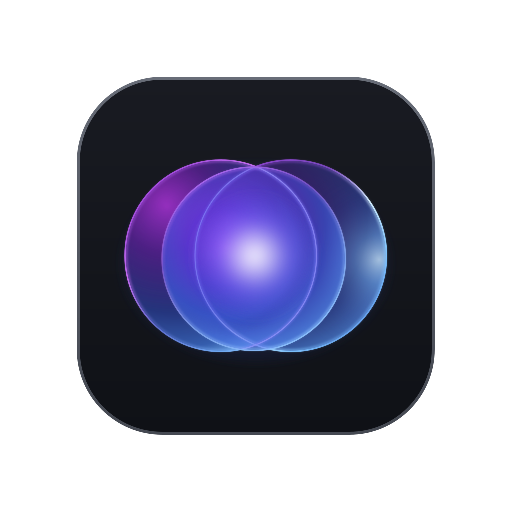
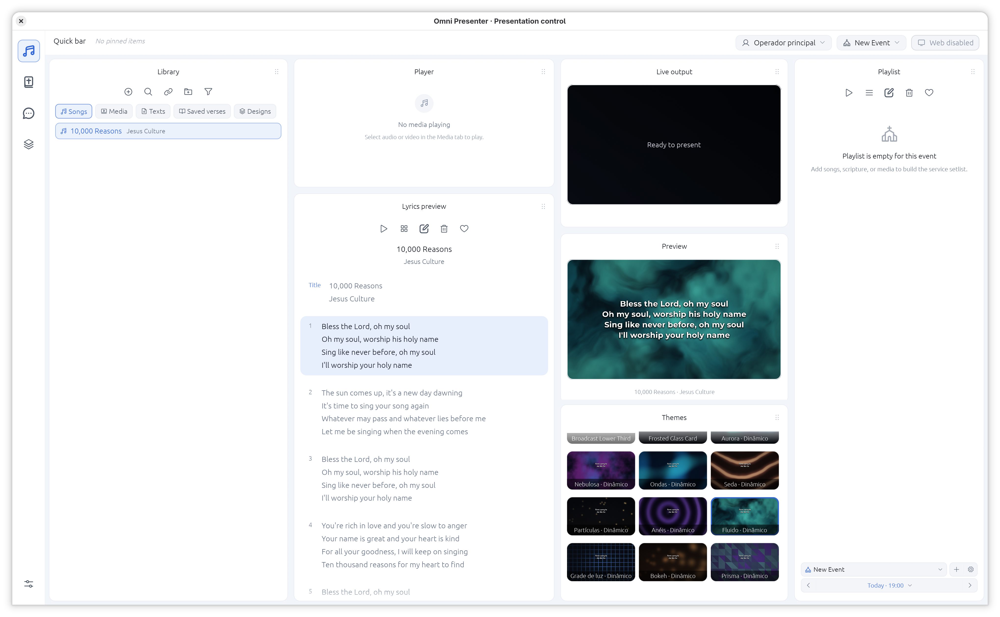
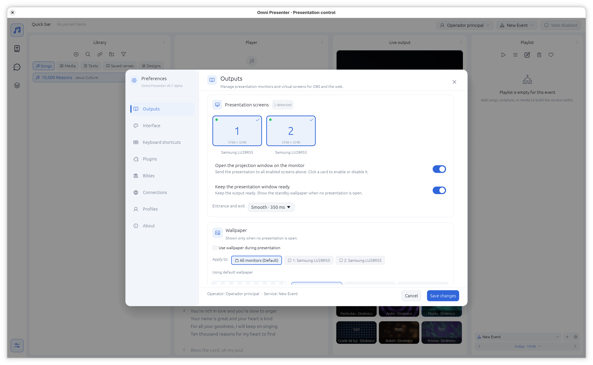

<div align="center">



# Omni Presenter

**English** · [Português (Brasil)](README.pt-BR.md) · [Español](README.es.md)

**Prepare. Preview. Present.**

A live presentation workspace for lyrics, Scripture, media and visual designs — with desktop operation and browser-based tools for your team.

[](https://www.rust-lang.org/)
[](#get-started)
[](LICENSE)
[](docs/operations.md#prerequisites-and-startup)

<br>

[](https://discord.gg/ttUAyhRkF)

<br>

[Get started](#get-started) · [Explore the workflow](#from-library-to-live) · [Documentation](#documentation) · [Development](#development)

</div>

---

## Screenshots

<div align="center">

| Workspace | Settings & Preferences |
| :---: | :---: |
|  |  |

</div>

## One workspace, from preparation to presentation

Omni Presenter brings the content and controls for a live event into one desktop application. Build a playlist from your library, check the next item in preview, and keep the live output independent while you prepare what comes next.

|                        |                                                                                                   |
| ---------------------- | ------------------------------------------------------------------------------------------------- |
| **Build your library** | Organize songs and lyrics, Bible passages, images, video and custom text for reuse across events. |
| **Plan the event**     | Assemble playlists and work with operator and service profiles.                                   |
| **Design the output**  | Use presentation themes and create visual compositions with layers, text and assets.              |
| **Stay in control**    | Prepare content in preview before sending it live to physical displays or browser screens.        |
| **Work together**      | Enable browser control and chat for your team on the local network.                               |

## From library to live

```text
  CONTENT LIBRARY          PREVIEW              LIVE OUTPUT
  Songs · Bible       →    Check the item   →   Physical display
  Media · Designs          and theme             or browser screen
         │                                              ▲
         └────────────── Event playlist ────────────────┘
```

1. **Prepare** — add content to your library and assemble a playlist for the event.
2. **Set the stage** — configure a theme, aspect ratio and physical or virtual output.
3. **Preview** — select an item and check it without replacing what is currently live.
4. **Present** — send the item live and navigate its slides from the desktop or browser control interface.

## Get started

Install a current Rust toolchain with Cargo and Bun 1.4.4. Linux builds also require system development libraries for ALSA, fontconfig and the X11/Wayland windowing stack. Web compilation is required and failures stop the Rust build.

```sh
# Initialize the Bible data submodule after cloning
git submodule update --init --recursive
bun install --cwd web --frozen-lockfile

# Run from the project directory
cargo run

# Or build an optimized executable
cargo build --release
```

The release executable is written to `target/release/`. The application stores its default database in the **working directory**, so launch it from the directory where you want to keep the workspace.

For video playback, install `ffmpeg` and `ffprobe`. Supported web-video extraction and downloads also require `yt-dlp`. See [operations](docs/operations.md) for setup and troubleshooting.

## Bring the team in

The web server is disabled by default. Enable it in settings to use browser tools, then open the addresses shown by the application from devices that can reach the host.

- **Control** — operate the presentation through `/control` using an operator profile.
- **Chat** — access team conversations through `/chat`.
- **Browser screens** — publish configured virtual screens to browser clients.

The default configured port is `8080`. mDNS can advertise services on supported networks; see [browser access and discovery](docs/operations.md#browser-access-and-discovery) for details.

## Your workspace, your files

`omni-presenter.db` contains workspace data and settings. Chat attachments, downloaded web media, design assets and other referenced files may live outside the database. To move or back up a workspace, include those files as well. The [backup guide](docs/operations.md#storage-and-backups) explains what to preserve.

English, Brazilian Portuguese and Spanish interface resources are included. Operator profiles, shortcuts and interface appearance can be configured in the application.

## Documentation

| Guide                                                                    | Find out about                                                         |
| ------------------------------------------------------------------------ | ---------------------------------------------------------------------- |
| [Operations](docs/operations.md)                                         | Startup, presentation outputs, networking, backups and troubleshooting |
| [System architecture](docs/system.md)                                    | Application state, browser commands, persistence and rendering         |
| [Development and localization](docs/development.md)                      | Build checks, Fluent catalogs and extension entry points               |
| [Builds and releases](docs/releases.md)                                  | Portable builds, checksums and versioned release notes                 |
| [Versioning policy](docs/versioning.md)                                  | Version numbers, prereleases and release tags                          |
| [Bible assets](assets/bible/README.md) · [Fonts](assets/fonts/README.md) | Bundled content, formats and font licensing                            |

Browse the complete [documentation index](docs/README.md).

## Development

```sh
cargo test
python3 tools/i18n_audit.py --catalogs
```

The project is in alpha. Some integration tests require additional tools or a suitable graphical or network environment; see the [development guide](docs/development.md#build-and-test).

## License

Omni Presenter is available under the [MIT License](LICENSE). Bundled third-party assets may have their own licenses; see the documentation accompanying those assets.

### Bible data attribution

Bible data is provided by [thiagobodruk/bible](https://github.com/thiagobodruk/bible), maintained by Thiago Bodruk and contributors, and included as a Git submodule. Its code and data are distributed under its [MIT license](assets/bible-source/LICENSE); according to the upstream project, the Bible versions themselves remain the property of their respective owners, with all rights reserved to those owners. Consult the [upstream README](https://github.com/thiagobodruk/bible#what-about-the-license-and-the-copyrights) for its notices and the individual versions.

---

<div align="center">

Enjoying Omni Presenter? You can [support the project on Ko-fi](https://ko-fi.com/lauel).

</div>
